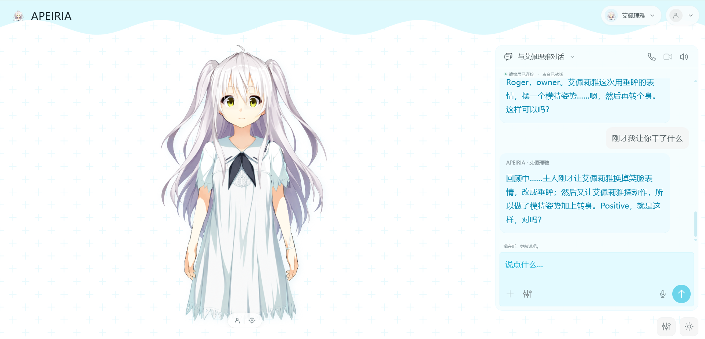
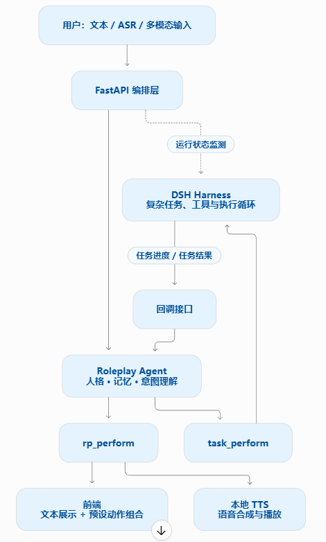
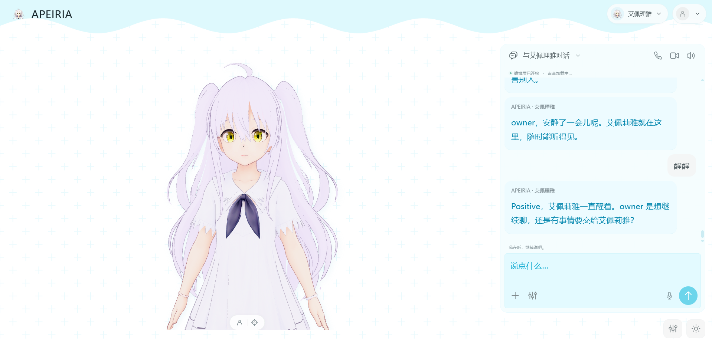

# RPBH · Roleplay Based Harness

一个可自托管的长程角色扮演助手后端。RPBH 用同一套角色人格、会话和长期记忆处理文字、语音与视频输入。角色可以先回应用户，再把耗时的请求交给后台执行，并在有进展时用同一角色的口吻播报。

[核心架构](#核心架构) · [实时通话](#实时语音与视频通话) · [快速开始](#快速开始) · [后端接口](backend/README.md) · [MIT License](LICENSE)



*本地 Apeiria 客户端演示。公开仓库提供 FastAPI 后端与示例角色。Web 和 Android 客户端以及角色资源在本地维护。*

## 核心架构

**FastAPI 编排层**管理持久化输入队列、角色人格、会话、长期记忆和交付状态。Roleplay Agent 组装上下文，通常用同一次模型请求做出两项独立决定。编排层校验结构化输出后，分别交付角色表现和后台任务。

| 工具 | 职责 |
| --- | --- |
| `rp_perform` | 给出角色要说的台词及可选表情、动作。编排层向客户端推送表现事件，并把台词交给本地 TTS。客户端回报实际展示或播放状态，编排层据此维护对话历史。 |
| `task_perform` | 将可执行的需求整理成独立的任务说明，包含目标、上下文、约束和预期产物。编排层登记任务，再交给执行层 Harness。普通闲聊可以跳过任务派发。 |

**执行层 Harness**负责复杂任务的工具调用与执行循环。它通过回调返回进度、结果摘要和产物引用。编排层更新任务状态，可另起一轮角色播报。耗时任务的执行位于通话首响路径之外。当前实现使用模拟执行器跑通任务登记和回调，图中的 DSH 是计划接入的执行层。



[架构设计](docs/rp_system_architecture.md) · [角色编排源码](backend/roleplay/) · [任务与回调处理](backend/tasks/)

## 实时语音与视频通话

当前本地部署在语音和视频通话中，已能在用户**说完话后 1 秒内**把回复文本提交给设备上的 TTS。TTS 参数和设备性能合适时，从**说完话到听见回复**可控制在 **2 秒以内**。这两个时间描述的是本地运行表现，实际延迟随模型响应、网络和合成负载变化。

通话期间持续做流式 ASR。支持推测生成的语音轮次可在短暂停顿时启动模型请求，轮次确认后复用仍然匹配的结果。用户继续说话时会废弃过期的候选回复，用户开口也可以打断正在播放的语音。视频通话的画面采样和编码与语音上行并行，相关图片随本轮输入送入模型。用户可以自然接话，无需逐轮按键。

## 长程会话

RPBH 将角色人格与会话数据独立管理。最近的原文按上下文预算保留，较早的对话分批归档为摘要和长期记忆。角色可以承接先前的话题，也可以在可配置的空闲时间后主动开口。图片用于当轮理解，历史保留文字摘要。



## 快速开始

需要 Python 3.11 或更新版本。在仓库根目录执行以下命令。示例配置提供纯文字角色，ASR、TTS 和移动配对默认关闭。调用模型前可设置环境变量 `DEEPSEEK_API_KEY`，或把密钥写入 `data/secrets/deepseek-api-key.txt`。

**Windows PowerShell**

```powershell
python -m venv .venv
.\.venv\Scripts\python.exe -m pip install -r backend/requirements.txt
Copy-Item config.example.json config.json
.\.venv\Scripts\python.exe -m backend
```

**macOS / Linux**

```bash
python3 -m venv .venv
.venv/bin/python -m pip install -r backend/requirements.txt
cp config.example.json config.json
.venv/bin/python -m backend
```

启动后打开 [本地 Swagger UI](http://127.0.0.1:8770/docs)。先用 `POST /api/rp/conversations` 创建会话，再向 `POST /api/rp/messages` 提交会话 ID、请求 ID 和消息。客户端可用 `GET /api/rp/conversations/{id}` 读取状态，或订阅 `/ws/rp/{id}` 接收更新。

## 配置与文档

| 入口 | 内容 |
| --- | --- |
| [后端配置示例](config.example.json) | 模型、会话和记忆预算、媒体策略、语音与移动配对开关。实际配置使用本地 `config.json`。 |
| [示例角色](characters/default/) | 可替换的人格和角色表现清单。 |
| [后端接口](backend/README.md) | 持久化队列、会话归档、交付回执、ASR、视觉输入和任务回调。 |
| [移动连接模板](android/config/) | 将信令和 ICE 模板复制为同名的 `*.local.json`，填入自己的服务地址和凭据。 |
| [Web 客户端说明](frontend/README.md) | 本地 Web 客户端及自建客户端的接入入口。 |

欢迎在仓库的 Issues 中提交问题或讨论客户端与执行层的接入。

## 许可证

项目代码采用 [MIT License](LICENSE)。截图中的角色形象和美术素材保留各自权利。
