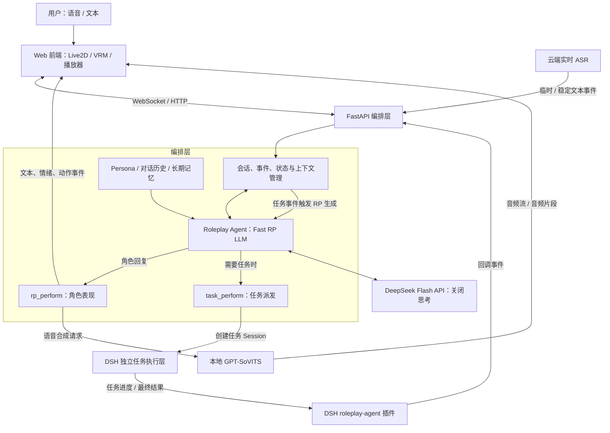
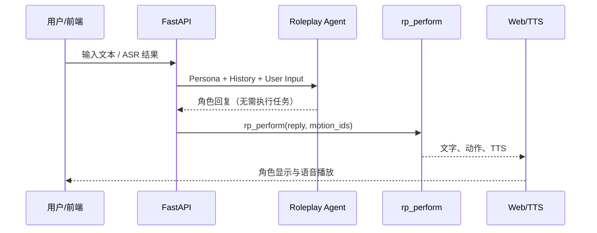
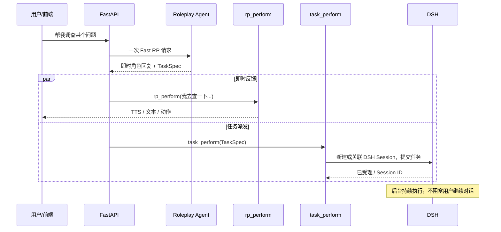
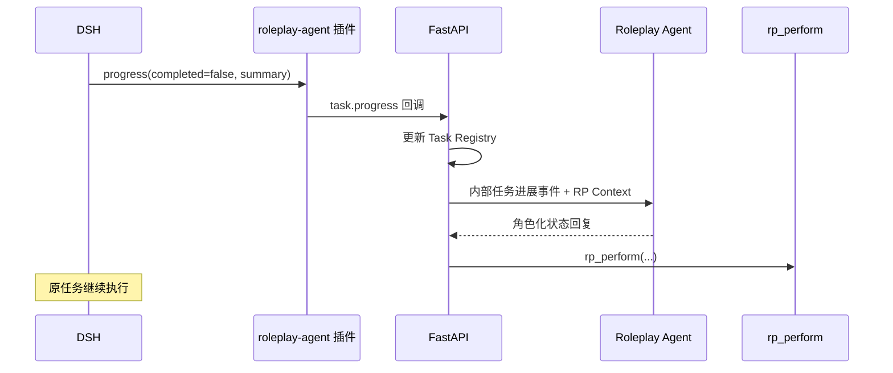
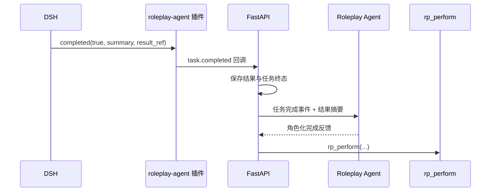

# RP 系统架构设计（初版）

> **文档定位**：面向具有角色人格、记忆、语音、动作和外部任务执行能力的通用 Roleplay（RP）系统。**Apeiria 只是其中一个具体角色配置**，不是系统架构的硬编码对象。
>
> **当前技术选型**：Python / FastAPI 编排层；云端 ASR；云端 DeepSeek Flash（Roleplay Agent，关闭思考）；本地 GPT-SoVITS TTS；Web 前端 Live2D / VRM；DeepSeek Harness（DSH）作为暂定的独立任务执行层。
>
> 本文区分**已确定的架构**与**建议的接口约定**。接口名称、字段和状态枚举是便于开发的设计草案，不代表现有代码已实现。

## 1. 设计目标与基本原则

系统的核心是一个能够持续扮演特定角色、理解用户输入并进行实时互动的 **RP Agent**。系统不仅返回文本，还能驱动角色立绘/3D 模型、合成角色语音，并在需要时将实际任务交给独立执行层。

目标包括：

1. **角色优先**：所有面向用户的互动都经过统一的角色人格和对话上下文，以角色口吻呈现。
2. **低延迟即时回复**：用户说完话后，尽快生成简短 RP 回复；不为识别“是否有任务”额外串行调用一次 LLM。
3. **任务执行独立**：编排层不承担复杂 Agent Loop；执行工具、检索、代码和长期任务交给 DSH。
4. **任务进度可反馈**：DSH 可在任务执行中或完成时主动通知编排层，再由 Roleplay Agent 以角色口吻呈现。
5. **多模态表现统一**：角色回复、前端文本、动作、情绪及本地 TTS 由同一套 `rp_perform` 机制协调。
6. **上下文分离**：RP 对话历史、角色记忆和 DSH 执行日志分开管理，仅交换必要的任务摘要与状态。
7. **角色可配置**：Persona、音色、形象资源、动作表等属于角色配置；更换角色无需修改主流程。

## 2. 总体架构

系统分为三个逻辑边界：

- **交互与编排层（FastAPI）**：RP 系统主服务，维护前端连接、Roleplay Agent、会话/记忆、任务状态，以及 `rp_perform` / `task_perform` 等调用能力。
- **任务执行层（DSH，暂定）**：独立的通用 Harness，使用其自身 System Prompt、Tool Schema、Agent Loop 和 Session 机制执行任务。
- **外部能力与表现层**：ASR、DeepSeek API、本地 GPT-SoVITS、Live2D/VRM 前端、数据库等。



> 图中的双向通道为逻辑关系。ASR 可以由前端建立连接并把转录事件发给 FastAPI，也可以由独立音频网关负责；前端最终使用 WebSocket 接收角色表现事件。实际音频传输方式可在实现时决定。

### 2.1 重要的边界

**Roleplay Agent 只负责“怎么理解、怎么说、是否委托任务”，不负责亲自执行复杂任务。**

**DSH 只负责“任务怎么做”，不负责维持对用户的长期 RP 人格或直接控制 TTS / Live2D。**

因此，原有 DSH 的 System Prompt 和工具体系原则上保持不变。编排层只向它提交经过 Roleplay Agent 解析后的**独立任务指令**，并接收结构化进度或结果。

## 3. FastAPI 编排层的组成

### 3.1 Roleplay Agent（轻量 Agent）

Roleplay Agent 是编排层核心。它不是另一套完整 Harness，也不需要复刻 DSH 的多步工具执行循环。它可以先实现为：**构造上下文 → 单次模型 Request → 解析角色回复及任务意图 → 调用编排层工具**。

**输入**：

- 当前用户输入：文本、ASR 转录快照或经过确认的本轮语音文本；
- 选定角色的 Persona / 行为约束；
- 当前 RP 会话中最近的有效对话；
- 按需检索的长期记忆；
- 与当前对话相关的任务状态简报；
- 编排层允许调用的工具及参数定义。

**输出/动作**：

- 必须或通常产生面向用户的角色回复：`rp_perform`；
- 若用户有可执行的需求，则同时或随后产生一个 `task_perform` 请求；
- 任务进度事件到来时，产生新的角色化状态播报，但**不再次派发原任务**。

模型使用 DeepSeek Flash **非思考模式**，优先短回复与快速首音。角色任务意图解析与文本生成由同一请求完成，避免“先分类，再生成回复”的额外串行 LLM Request。

**关于工具调用轮次的约束**：一次用户输入可能同时需要 `rp_perform` 和 `task_perform`，但系统不应该为了执行这两个本地动作，强制再进行额外一轮 LLM 生成。第一版可以选择一次模型输出包含两个结构化动作，或使用单次模型响应中的多个 Native Tool Calls，由 FastAPI 校验后分别执行。是否采用 Native Tool Calling，取决于接入 API 的实际能力和响应格式；业务语义不变。

### 3.2 `rp_perform`：角色表现工具

**用途**：将 Roleplay Agent 已经决定的角色回复转化为前端可呈现的具体交互。它是编排层自己的表现能力，不负责思考用户意图。

建议参数示例：

```json
{
  "text": "好的，owner，我去查看一下。",
  "emotion": "curious",
  "motion_ids": ["nod_small"],
  "voice": {"enabled": true},
  "conversation_id": "conv_123",
  "turn_id": "turn_456"
}
```

**执行内容**：

1. 将角色文本发送到 Web 前端，在消息区或角色气泡中显示。
2. 校验 `motion_ids` 是否在当前角色的预设动作表内，并通知 Live2D / VRM 播放动作。
3. 向本地 GPT-SoVITS 服务提交待合成文本；将得到的音频片段或流交给前端播放。
4. 更新消息、播放和动作状态；需要时处理队列和取消。
5. 在回复被实际交付后，将对应的角色台词写入正式 RP 对话历史。

动作只输出**预定义动作 ID**，而不让 LLM 直接生成骨骼参数或任意模型控制指令。Live2D 和 VRM 可以各自将相同的语义动作 ID 映射到具体动画。

建议 `rp_perform` 的接口返回代表**已入队/已受理**，而不是等待整段 TTS 合成及播放完成。文本、动作与音频可以独立流转。

### 3.3 `task_perform`：任务派发工具

**用途**：接收 Roleplay Agent 提取出的可执行任务，创建任务记录，然后将任务送往独立的 DSH 执行层。

建议参数示例：

```json
{
  "instruction": "检索指定游戏的最近版本更新，整理值得关注的变化。",
  "task_type": "research",
  "context": {
    "user_goal": "了解游戏最近更新了什么",
    "relevant_facts": ["用户主要关注玩法变化"]
  },
  "conversation_id": "conv_123",
  "source_turn_id": "turn_456"
}
```

**执行内容**：

1. 校验任务意图、参数和权限，创建唯一的 `task_id`。
2. 保存任务与 RP 会话、用户消息之间的关联。
3. 为任务创建/关联 DSH Session，提交任务指令。
4. 立即向编排层返回“已受理/已派发”，不等待 DSH 完成。
5. 后续通过 DSH 插件的回调接收状态更新。

编排层不负责重写 DSH 的 System Prompt，也不把 RP 的大量人格指令直接塞入 DSH。DSH 接收的重点是**清晰、可执行、具有必要上下文的任务需求**。

> 对读取、搜索、分析等无副作用任务，可以在轮次正式确认后直接派发；对于删除、购买、修改重要资料等有副作用的任务，需要适当的授权/确认。尤其不能把 ASR 的尚未确认的推测文本直接当作不可撤销操作的授权。

### 3.4 会话、记忆与状态服务

编排层维护：

- **角色配置（Character Profile）**：Persona、风格、称呼、角色模型资源、音色、预设动作映射。
- **RP Conversation**：用户输入、角色实际说出的回复、消息顺序与本轮状态。
- **Long-term Memory**：角色相关记忆、用户明确提供的信息和可检索的长期事实。
- **Task Registry**：`task_id`、任务摘要、DSH Session ID、任务状态、最新进度、最终结果。
- **Playback / UI State**：当前播放语音、待播放片段、动作状态、打断标记。

建议把角色 Profile 与运行时 Session 分开：一个系统可以有多个角色实例和多段 RP 会话，而不需要复制编排逻辑。

## 4. DSH 任务执行层与回调插件

### 4.1 执行责任

DSH 维持它现有的 Agent Loop、工具注册、任务历史、任务决策和执行逻辑。收到 `task_perform` 的任务之后，就按正常 Harness 方式开展工作。

一次任务至少关联：

```text
RP conversation_id
  └── task_id
        └── DSH session_id
```

复杂任务所需的长 Context 留在 DSH 内部。**RP Conversation 不应直接存入 DSH 的完整工具调用日志、思考过程或原始执行轨迹。**

### 4.2 DSH → 编排层：`roleplay-agent` 插件

这里的 **`roleplay-agent` 插件**专指安装在 DSH 内、负责**向编排层发送任务消息的工具/桥接组件**。它与编排层内的 Roleplay Agent 实例是不同概念。

建议将插件的对外事件命名为 `task.progress`、`task.completed`、`task.failed`，实现上可以保留你计划的插件名称 `roleplay-agent`。

建议回调结构：

```json
{
  "task_id": "task_789",
  "phase": "progress",
  "completed": false,
  "summary": "已经找到最近的版本公告，正在整理玩法变动。",
  "details": {
    "completed_steps": ["检索版本公告"],
    "next_step": "对比重要机制变化"
  },
  "event_id": "evt_001"
}
```

任务结束时：

```json
{
  "task_id": "task_789",
  "phase": "completed",
  "completed": true,
  "summary": "已整理版本更新，包括两项玩法调整和三项平衡性改动。",
  "result_ref": "task-result://task_789",
  "event_id": "evt_002"
}
```

`result_ref` 只是示意：完整结果可以保存在任务存储中，回调只传必要摘要及结果位置，不要求将全部日志塞进 RP 上下文。

### 4.3 长任务期间的进度播报

DSH 执行时间较长时，可以按关键进展或一定间隔调用插件，向编排层发送 `phase=progress` / `completed=false` 的消息。

编排层收到后：

1. 校验回调来源和 `task_id`，更新任务状态。
2. 把经过整理的当前任务进展作为**内部事件**交给 Roleplay Agent。
3. Roleplay Agent 结合 Persona 与对话上下文，调用 `rp_perform` 生成可选的角色化状态反馈。
4. **DSH 继续执行原任务**。进度播报不应等待 TTS 播放完毕，也不应要求 DSH 终止任务。

注意：由 LLM 自主决定调用插件，不能严格保证每隔 N 秒调用一次。如果未来需要硬性的定时通知，应由任务状态管理/外部定时机制实现；第一版可以把“关键节点或适当时间间隔发送”作为对 DSH 的工具使用要求。

### 4.4 任务完成

DSH 完成任务后通过相同插件发送 `phase=completed` / `completed=true` 与结果摘要。编排层更新 Task Registry，再触发一次 Roleplay Agent 的角色回复，并经 `rp_perform` 更新 UI、动作和本地 TTS。

这里的角色化播报会产生**新的独立 RP 请求**，但发生在任务完成时，**不会增加用户最初发言的即时回复延迟**。

失败或取消也应使用明确的 `failed` / `cancelled` 状态，不要用 `completed=true` 表示所有终态。

## 5. 四类核心交互流程

### 5.1 纯 RP 对话：无任务



普通闲聊不触发 `task_perform`。

### 5.2 用户发出复杂任务



一次用户输入在业务层可同时调用两个工具，但只有 Roleplay Agent 的**一次必要模型请求**位于即时回复的关键路径中。

### 5.3 任务中途推送进度



### 5.4 任务结束并播报结果



## 6. 语音输入、推测断句与打断

ASR 与 TTS 是 RP 系统的输入和表现通道，复杂任务是否运行不改变这条实时语音路径。

### 6.1 已确定的输入策略

- **云端 ASR 保持长连接**，持续获得可修订的实时转录及云端稳定句子；不要求每一句都发送 `end` 并断开连接。
- **本地 VAD 静音约 300ms**：截取当前转录快照，触发一次推测式 Fast RP 请求。
- **静音累计约 800ms**：默认确认本轮输入，可交付已经准备好的回复。
- **300～800ms 内用户继续讲话**：取消尚未交付的旧请求，修订同一个用户轮次的文本；下次静音时尝试重新请求。
- **同一轮最多两次推测**：两次均因续话失效后，等待云端 ASR 自动稳定断句，再发起正式回复。
- **超过默认轮次边界后再次讲话**：按新的用户轮次处理；不是简单地判定一定产生一个新的 DSH 任务。
- **角色 TTS 播放期间用户开口**：第一版直接停止当前 TTS 播放、清空未播的音频队列，转为处理新用户输入，不实现复杂的附和或误打断恢复。

这里的 300ms、800ms 是第一版的策略值，后续根据真实麦克风与用户体验测试调整。

### 6.2 输入修订与并发控制

为每个用户轮次维护：

```json
{
  "turn_id": "turn_456",
  "revision": 2,
  "transcript": "帮我看看现在的游戏更新",
  "speculative_attempts": 1,
  "state": "speculating"
}
```

每次修订 `revision` 增加；旧模型请求即使在取消后返回，也必须在提交 `rp_perform` / `task_perform` 前校验 Revision，避免过期回复污染 UI、历史和任务队列。

ASR 的非稳态文本会被修正，不应简单将每次回调追加到字符串末尾，而应按语音片段序号/区间更新当前 Transcript。

### 6.3 语音输出

- 使用本地、常驻的 **GPT-SoVITS** 合成角色语音；本地 TTS 性能优化暂时不改变总体架构。
- `rp_perform` 把回复文本按必要的自然句/片段送入 TTS，前端依次播放。
- 即时回复尽量简洁；长任务结果可以分段播报。
- TTS 生成与播放不同步时，以音频队列管理待播片段；打断时取消/丢弃旧版本剩余音频。
- 正式对话历史只记录**实际交付**的回复；如只播出部分，应以可确认的已播放文本为准，而不是把全部待合成文本都写入已说出历史。

### 6.4 早期延迟基准（设计阶段参考）

此前测得的大致量级：

| 环节 | 设计阶段参考数据 | 说明 |
|---|---:|---|
| ASR 识别 | 用户开口到首字约 0.45～0.56s | 与用户说话过程重叠，通常不整段叠加在“说完后”延迟中 |
| 推测断句 | 300ms 启动，800ms 默认确认 | 设计策略，不是模型测试耗时 |
| DeepSeek Flash（非思考）TTFT | 约 0.52～0.87s | 来自不同短文本测试，存在波动 |
| DeepSeek 输出速度 | 约 100～120 Token/s | 实测量级 |
| 本地 TTS 实际短句首 PCM | 约 1.16s | 热态少量样本中位数 |
| 本地 TTS 实际短句首次可听 | 约 1.32s | 估算值，尚非声卡回环实测 |

设计阶段将各环节的样本组合，估算常规短句从用户说完到角色第一次发声约需 2～3 秒。集成后本地通话的表现见 [README 的实时通话说明](../README.md#实时语音与视频通话)。

## 7. 上下文与记忆边界

### 7.1 Roleplay Agent Context

每次 Fast RP 请求按需组合：

```text
角色固定 Persona / 风格约束
+ 当前角色状态及适用的工具定义
+ RP 最近对话历史
+ 检索到的相关长期记忆
+ 简短 TaskSnapshot（如有运行中的任务）
+ 当前用户消息 / 内部任务事件
```

Roleplay Agent 不加载整个 DSH System Prompt、全部 Tool Schema 与完整工具日志。它只需要理解角色、用户、任务状态，以及调用两个编排层工具的方法。

### 7.2 DSH Context

DSH 收到独立的 TaskSpec 后，按其原有 Agent Session 维护工具、执行步骤和必要的长 Context。任务执行层不需要为了 RP 首音速度而压缩自己的全部历史。

### 7.3 跨层传递的信息

- **RP → DSH**：任务目标、相关事实、必要约束、用户授权、任务关联 ID。
- **DSH → RP**：任务 ID、执行状态、用户可理解的进度摘要、完成结果或结果引用。
- **不直接跨层传递**：与用户回复无关的详细工具日志、大段中间轨迹和冗余 Prompt。

记忆更新接口可以由前端、管理模块或受控事件触发；**不能把任意 DSH 工具输出无校验地直接写入角色的长期记忆**。

## 8. 接口与事件草案

> 以下是推荐的第一版接口命名，供后续 FastAPI 实现时调整；尚未固定为产品协议。

### 8.1 FastAPI 外部接口

| 接口 | 用途 |
|---|---|
| `POST /api/rp/message` | 提交文字消息或已确认的 ASR 文本 |
| `WS /ws/rp/{conversation_id}` | 上报语音/ASR/VAD 事件；下发角色文本、动画、音频与任务通知 |
| `GET /api/rp/conversations/{id}` | 获取 RP 对话与当前状态 |
| `POST /api/rp/memory` | 新增/更新受控长期记忆 |
| `GET /api/rp/tasks/{task_id}` | 查询任务状态和结果摘要 |
| `POST /api/internal/task-events` | 接收 DSH 插件的进度/结束回调（需认证） |

### 8.2 内部事件

| 事件 | 来源 | 接收方 |
|---|---|---|
| `user.transcript.updated` | ASR / 前端 | 输入轮次管理器 |
| `user.turn.speculative` | VAD | Roleplay Agent |
| `user.turn.committed` | 轮次管理器 | 对话管理器 / Roleplay Agent |
| `rp.message` | `rp_perform` | 前端 |
| `rp.motion` | `rp_perform` | Live2D / VRM 控制器 |
| `rp.audio` | 本地 TTS 适配器 | 前端播放器 |
| `task.created` | `task_perform` | Task Registry |
| `task.progress` | DSH 插件 | Task Registry → Roleplay Agent |
| `task.completed` / `task.failed` | DSH 插件 | Task Registry → Roleplay Agent |
| `rp.interrupted` | 前端 / VAD | 回复与播放队列 |

### 8.3 必须处理的可靠性问题

1. **非阻塞入队**：`rp_perform`、`task_perform` 返回受理状态，不等待 TTS 播放或 DSH 任务完成。
2. **过期请求隔离**：所有候选回复绑定 `turn_id + revision`；取消后晚到的结果不可继续派发任务或播音。
3. **任务幂等性**：一个正式用户意图创建唯一 `task_id`；重试、回调重放不可重复执行同一操作。
4. **回调鉴权**：DSH 插件到 FastAPI 的内部接口需要身份校验与可信任务 ID。
5. **任务状态机**：建议 `pending → running → completed / failed / cancelled`；中途 `progress` 不改变任务为终态。
6. **进度播报控制**：多任务、频繁进度可能打断正常对话；任务事件可以排队、合并或只保留关键更新。
7. **TTS 与输入并发**：用户打断后停止音频队列并撤销旧版本；后续完成的旧音频不能重新播放。
8. **状态持久化**：RP 对话和任务关联信息应在进程重启后可恢复；WebSocket 断开不等于任务取消。

## 9. 典型角色配置（Apeiria 仅作实例）

```yaml
character_id: apeiria
name: Apeiria
persona_file: characters/apeiria/persona.md
memory_namespace: characters/apeiria
tts:
  provider: local_gpt_sovits
  voice_profile: apeiria_v5_turbo
avatar:
  web: live2d_or_vrm
  motion_mapping:
    nod_small: <角色资源中的预设动作标识>
    idle: <角色资源中的预设动作标识>
```

这里的资源文件路径、音色标识与动作键均为示例。更换角色时，替换配置与资源即可，`roleplay-agent`、`rp_perform` 和 `task_perform` 的通用协议不变。

## 10. 第一版实现范围与建议开发顺序

### 第一阶段：跑通最小 RP 闭环

- FastAPI WebSocket + Web 前端基本消息与动作事件；
- 角色配置、最近对话历史；
- Roleplay Agent 单次 DeepSeek 请求；
- `rp_perform` 驱动前端、Live2D/VRM 预设动作及本地 GPT-SoVITS；
- 普通文本对话及语音播放打断。

### 第二阶段：接入实际语音输入

- 腾讯云 ASR 长连接转录事件；
- 300ms 推测 / 800ms 默认确认；
- `turn_id`、`revision`、两次推测上限；
- 推测失败后等待 ASR 稳定断句。

### 第三阶段：接入 DSH 任务链路

- `task_perform` → DSH Session；
- DSH 的 `roleplay-agent` 桥接插件；
- `progress` / `completed` / `failed` 事件回传；
- 任务事件触发 Roleplay Agent，再调用 `rp_perform` 播报。

### 第四阶段：完善持久化和多任务

- 长期记忆管理；
- 会话恢复、任务记录与结果引用；
- 多任务的进度播报调度、打断优先级和可靠性；
- 端到端延迟与错误率统计。

## 11. 当前明确不做的事情

- 不在编排层重新实现完整 DSH Harness、工具执行循环、浏览器/Computer Use 等复杂能力。
- 不为了判断“用户是否在布置任务”增加一轮必需的串行 LLM 请求。
- 不改写 DSH 现有 System Prompt 或工具体系来迎合 RP 人格。
- 不要求 DSH 的长任务在首句语音出现前完成。
- 不把尚未交付的推测回复写入正式角色对话历史。
- 当前不更换本地 GPT-SoVITS，也不优先优化 LLM 推理侧的 KV Cache / Prefix Cache。
- 当前不实现复杂的全双工语义打断恢复；用户插话时直接停止本轮 TTS。

---

## 12. 架构总结

**编排层 = 角色系统本体**：以 FastAPI 承载 Roleplay Agent、角色人格和记忆、前端通信，以及 `rp_perform` / `task_perform` 两个核心动作。

**`rp_perform` = 角色表现出口**：统一负责文本、预设动作、TTS 与前端状态。

**`task_perform` = 复杂任务入口**：把经过 RP 解析的需求转交 DSH，立即返回，不阻塞即时互动。

**DSH 插件 = 任务反馈入口**：任务中可推送进度，任务结束推送结果；编排层收到后再次由 Roleplay Agent 进行角色化表达。反馈只形成新的 RP 表现，不应重新派发原任务。

整个系统的基本运行模式是：**用户与 Roleplay Agent 持续对话，复杂任务在 DSH 独立运行，所有用户可见的角色文字、动作与声音统一由编排层呈现。**
